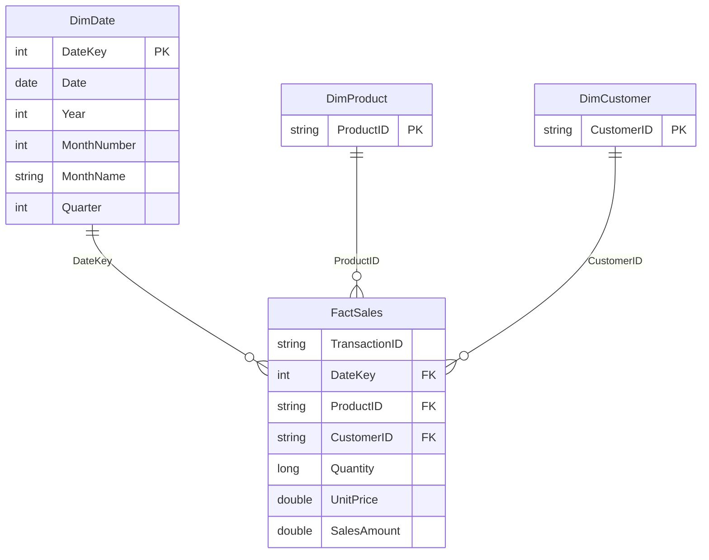

# Gold Layer — Star Schema Diagram

## Model Description

The Gold analytical model follows a star schema design.

- **FactSales:** Transaction-level sales data.
- **DimDate:** Calendar attributes for time-based reporting.
- **DimProduct:** Distinct product identifiers.
- **DimCustomer:** Distinct customer identifiers.

Each dimension has a one-to-many relationship with FactSales.

The model supports interactive filtering and DAX-based sales analysis in Power BI.
