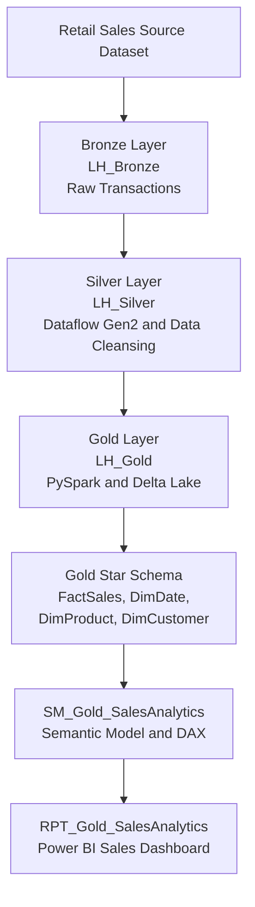

# Microsoft Fabric — Solution Architecture

## Exercise 03: Medallion Architecture & Retail Sales Analytics

## Architecture Overview

The solution follows the Medallion Architecture pattern in Microsoft Fabric.

- **Bronze:** Stores raw retail sales transactions.
- **Silver:** Cleans and validates transactional data using Dataflow Gen2.
- **Gold:** Uses PySpark and Delta Lake to prepare a dimensional star schema.
- **Semantic Model:** Defines relationships and DAX measures.
- **Reporting:** Delivers interactive sales performance analytics through Power BI.

## Validated Results

| Metric | Result |
|---|---:|
| Valid sales transactions | 991 |
| Total sales revenue | 96,457.89 |
| Total units sold | 2,979 |
| Average transaction value | 97.33 |
| Missing dimension relationships | 0 |
| Duplicate transaction IDs | 0 |

*This is a completed hands-on learning project using a retail sales sample dataset.*
